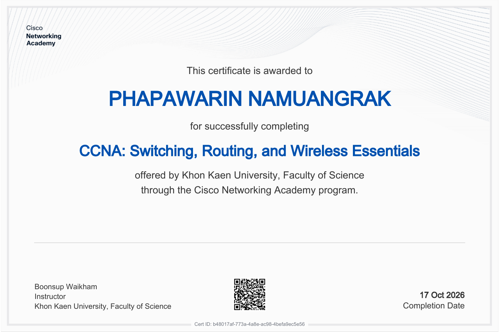
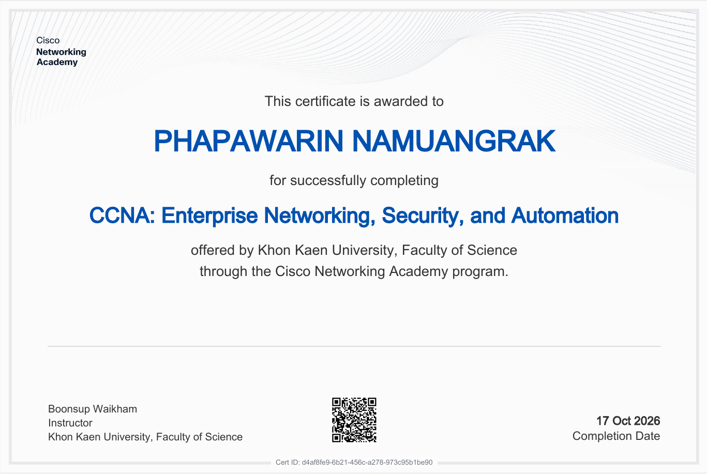

# Internetworking2026-1
นางสาวปภาวรินทร์ นาเมืองรักษ์ 673380275-5 section 1

Repository สำหรับเก็บไฟล์ Lab, Project และ Portfolio ส่วนตัว

## Certificate
---
### CCNA: Switching, Routing, and Wireless Essentials

### CCNA: Enterprise Networking, Security, and Automation

---
## Final Project (Capstone Project)

1. Network Programmability 

https://github.com/LynxelSins/NetworkProgrammability.git 

*main dev* 

2. 23.2.2 Packet Tracer - Explore a NetFlow Implementation 

https://github.com/poranunb-design/Capstone-project-2
 
 
3. 26.1.6 Lab - Implement CoPP - ILM 

https://github.com/kojidesu01/Lab-Implement-CoPP
 
 
